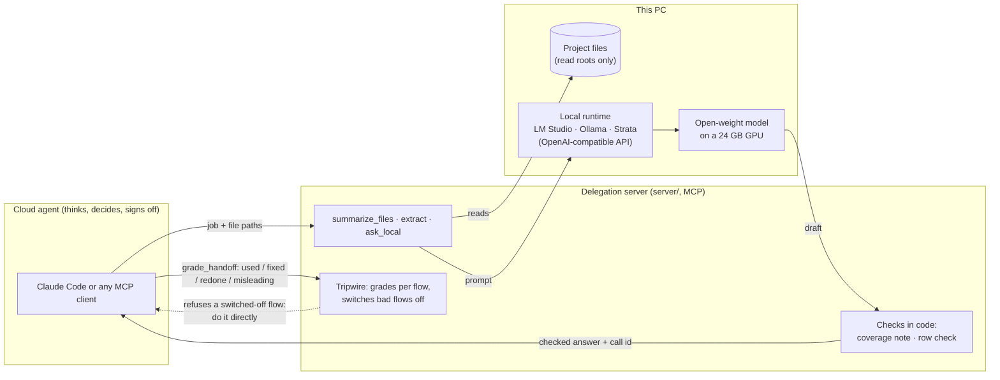

# Offload

A local AI system on one desktop PC that takes over the work a local model can do well, so that paid
cloud-agent tokens are spent only where they earn their cost: logic, design, and checking facts and
programs.

The cloud agent (Claude Code, in practice) stays the thinker. Reading, condensing, extracting, drafting
routine code and first-pass reviews move to open-weight models running on an AMD Radeon RX 7900 XTX
(24 GB). **How far delegation goes is decided by measurement on this machine, not by assumption**, and
every number below was measured here.

## How it works



- **The cloud agent** hands over a job and file paths, never the file contents, so bulk text never
  enters its context. It grades every answer it uses.
- **The server** reads the files, asks the local model, and checks the draft in code before returning
  it: a summary comes with a list of every section, class or method it never cited; extracted rows are
  kept only if every value is found word for word in the file.
- **The tripwire** switches a flow (tool, mode, model) off when its answers keep being redone, or at once
  when one misleads about code; the cloud agent then does that job itself.
- **The benchmark harness** (`bench/`) decides which model serves which job, with the same suite on every
  runtime, backend and model.

A real call, checked line by line, is in [`docs/samples/extract-tuning-fields.md`](docs/samples/extract-tuning-fields.md):
16 tuning values pulled from a 592-line Unity script in 48 seconds, with the cloud agent receiving 745
characters instead of the file's 25,242.

## What exists

- **A benchmark harness** (`bench/`) that runs the same suite against any runtime, GPU backend and model
  through the OpenAI-compatible API: speed and VRAM fit, standard benchmarks through
  [Inspect AI](https://inspect.aisi.org.uk/) (GPQA, MMLU-Pro, IFEval, BFCL, MATH, AIME), and fresh
  real-work tasks written after every candidate model was released, so none can have memorised them:
  coding to a spec in C#, TypeScript and Python with hidden tests in a Docker sandbox, finding bugs,
  extracting facts from long documents, and reviewing model-written code. Long runs go through a
  restartable queue and ran unattended overnight. A two-minute gate skips the long tests for any model
  that an already-measured model beats on score, speed and memory at once.
- **A delegation server** (`server/`), a small MCP server in TypeScript that any MCP client can call.
  It reads files itself, so bulk text never enters the cloud model's context, and it checks the local
  model's output in code before returning it:
  - `summarize_files`: a terse summary with `file:line` references, followed by a coverage note, made by
    code, naming every Markdown section, class or method the summary never cites.
  - `extract`: every item of a kind as rows of values the model copied; code checks each value word for
    word against the file and drops rows that do not match, saying why.
  - `ask_local` and `offload_stats` (every call is logged, so savings are counted, not guessed).
- **A deterministic filter** (`server/filters/unity-tests.ts`) that turns a Unity test run into counts plus
  the failures with `file:line`. It was written by one local model and reviewed by another, in the
  project's first live trial of local writing with cloud sign-off.
- **A plain-language explainer** (`docs/for-logan/index.html`): how local AI works on this exact
  machine, VRAM, quantization, runtimes, and what the measurements mean. Logan asked for it so that he
  learns the fundamentals behind each decision rather than taking the agents' word for them, and it is
  kept current as results arrive.

## What the measurements say

Ten model builds were benchmarked on two runtimes (LM Studio and Ollama) and two GPU backends (Vulkan
and ROCm); five were kept. Full tables are in `bench/results/summary.md`.

| Job | Where it goes | Evidence (measured here) |
|---|---|---|
| Reformat, convert, follow a template | Local, any model | Instruction following 95–98% on all five kept models |
| Routine code to a clear spec | Local writer, tests, local reviewer, cloud sign-off | Gemma 4 26B passes 89% of fresh problems' hidden tests with thinking off, at up to ~150 tokens/s |
| Review code against its spec | Local, Qwen3.8 27B or Gemma 4 31B | 81–87% of real bugs caught with 11–16% false alarms, on 232 model-written solutions |
| Pull facts out of long documents | Local, row method | 92–100% when the model only copies rows and code computes the answer, against under 45% free-form |
| Hard reasoning, design, planning | Cloud | Graduate-level science questions: 63–77% locally against ~91% published for frontier models |

Findings that changed the design:

- **Let the model copy, let code compute.** Free-form extraction with thinking off scored under 45% on
  every model. Asking only for rows of copied values, in small chunks, and computing the answer in code
  scored 92–100% on the four larger models, faster than thinking mode. The `extract` tool is built on it.
- **One sentence in a prompt halved false alarms.** Reviewers told to judge only against the
  specification, and to name an input the spec covers for any bug they claim, raised fewer false alarms
  for all five models (Qwen3.8 27B: 22% to 11%) with catches within noise.
- **"Saving tokens" by writing terse code broke it.** Pass rates fell from 83% to 56% (Qwen3.8) and
  44% to 6% (Qwen3.5 9B). Stripping comments from code a reviewer reads looked free with the first
  review prompt and turned out worse with the second, so reviewers get code as written.
- **A silent timeout looked like a flaky GPU runtime.** Long thinking-mode answers went missing. The
  cause was the evaluation library's own 600-second HTTP timeout, found by sending the same long
  requests straight to the runtime (all returned, the slowest after 16 minutes). The server sets its own
  timeout to 30 minutes.
- **Check that "thinking off" is really off.** One candidate wrote ~2,800 reasoning tokens per answer
  with thinking switched off, which made its fast-mode scores unfairly good until it was caught.

## How it is built

Logan Smith is new to local AI; this project is where he is learning it. He sets the goals, contributes
design ideas, makes the decisions and reviews the results; the code and documentation are written by
AI coding agents (Claude Code), working under the rules in
[`AGENTS.md`](AGENTS.md): provider-agnostic by design (OpenAI-compatible API, MCP, models in config),
every recommendation backed by numbers measured on this machine, honest reporting of what did and did
not run, and Logan's approval for anything that touches the machine. How that collaboration works, and
where measurement overturned the agents' own first readings, is in
[`docs/BUILDING-WITH-AI.md`](docs/BUILDING-WITH-AI.md). The roadmap, including what is planned but not
built, is in [`docs/PLAN.md`](docs/PLAN.md).

## Layout

| Folder | Purpose |
|---|---|
| `bench/` | Benchmark harness, task definitions, queues and committed result summaries |
| `server/` | The delegation server (MCP), its filters and tests |
| `docs/` | Plan, how it was built, how the public snapshot is published, and the plain-language explainer |
| `tooling/` | Machine setup and the public-snapshot script |

## Running it

**Without a GPU (five minutes).** The server's tests run every tool end to end against a fake
OpenAI-compatible model, including the code checks and the tripwire:

```powershell
cd server
npm install
npm test
```

**With a local model.**

1. Install [LM Studio](https://lmstudio.ai/) (or Ollama), and Node 24 or later.
2. Download a model. Any instruction-tuned GGUF works; the measured default for fast jobs is Gemma 4 26B
   A4B (about 15 GB, needs a 24 GB GPU). On a smaller card, Qwen3.5 9B (about 10 GB) runs the same tools,
   less accurately:
   ```powershell
   lms get https://huggingface.co/google/gemma-4-26B-A4B-GGUF
   lms server start
   ```
3. In `server/config.json`, set `endpoint` and the model names under `roles` to match. Create
   `server/config.local.json` with the folders the server may read, for example
   `{ "readRoots": ["C:/path/to/a/project"] }`. The server loads models itself and unloads them after 15
   idle minutes.
4. Connect an MCP client. Claude Code picks the server up from `.mcp.json` when it is started in the
   project folder; other clients run `node server/src/index.ts` over stdio. Then ask the agent to
   summarise or extract from files under a read root.

**Benchmarks:** Python 3.12, LM Studio or Ollama, and Docker for the coding tasks. See
[`bench/README.md`](bench/README.md); the server's details are in [`server/README.md`](server/README.md).

## Status

Work in progress, started October 2026. Measured so far: runtimes, models, prompts and the quality of
local work. Not yet measured: the end-to-end saving in cloud tokens per finished change, which is the
project's real success measure, and the loop coordinator that will run write, test and review rounds
locally before the cloud agent sees the result.

## Hardware

AMD Radeon RX 7900 XTX (24 GB, RDNA 3), AMD Ryzen 9 7900X, 32 GB DDR5-6000, Windows 11.

## Models and third-party software

No model weights are in this repository; each is downloaded by its runtime.

| Model | Size | Source | Licence |
|---|---|---|---|
| Qwen3.5 9B (Q8_0) | 9B | [Qwen/Qwen3.5-9B](https://huggingface.co/Qwen/Qwen3.5-9B) | Apache 2.0 |
| Qwen3.6 35B-A3B, MTP build (IQ4_XS) | 35B, 3B active | [unsloth/Qwen3.6-35B-A3B-MTP-GGUF](https://huggingface.co/unsloth/Qwen3.6-35B-A3B-MTP-GGUF) | Apache 2.0 |
| Qwen3.8 27B (Q4_K_XL) | 27B | [Qwen/Qwen3.8-27B](https://huggingface.co/Qwen/Qwen3.8-27B) | Apache 2.0 |
| Gemma 4 26B A4B (QAT Q4_0) | 25B, 3.8B active | [google/gemma-4-26B-A4B-it](https://huggingface.co/google/gemma-4-26B-A4B-it) | Apache 2.0 |
| Gemma 4 31B (QAT Q4_0) | 31B | [google/gemma-4-31B-it](https://huggingface.co/google/gemma-4-31B-it) | Apache 2.0 |
| Qwen3.8 Flash Next, Coder (IQ1_M, via Strata) | 125B MoE, pruned to half its experts | [Strata models](https://github.com/Niko1221/Strata/blob/main/docs/MODELS.md) | not stated by Strata; unverified |

| Software | Used for | Licence |
|---|---|---|
| [MCP TypeScript SDK](https://github.com/modelcontextprotocol/typescript-sdk) 1.32 | the server's MCP interface | MIT |
| [Zod](https://zod.dev/) 4.6 | tool argument schemas | MIT |
| [Inspect AI](https://inspect.aisi.org.uk/) 0.3.281 and inspect_evals 0.24.0 | benchmark runner and standard tasks | MIT |
| [OpenAI Python client](https://github.com/openai/openai-python) | the OpenAI-compatible API | Apache 2.0 |
| PyYAML, SymPy, ANTLR 4 runtime | config; maths scoring | MIT; BSD; BSD |
| [instruction_following_eval](https://github.com/josejg/instruction_following_eval) | IFEval scoring | Apache 2.0 |
| [Strata](https://github.com/Niko1221/Strata) 0.1.47 | expert-offload runtime (optional) | MIT |
| LM Studio, Ollama, Docker | runtimes and the coding sandbox, installed separately | their own terms |

The benchmark datasets (GPQA, MMLU-Pro, IFEval, BFCL, MATH, AIME) are fetched by inspect_evals at run
time and carry their own licences; none is copied here. The fresh real-work tasks in `bench/tasks/` were
written for this project.

## Licence

None. The source is visible for portfolio review; no licence to use, copy or modify it is granted.
